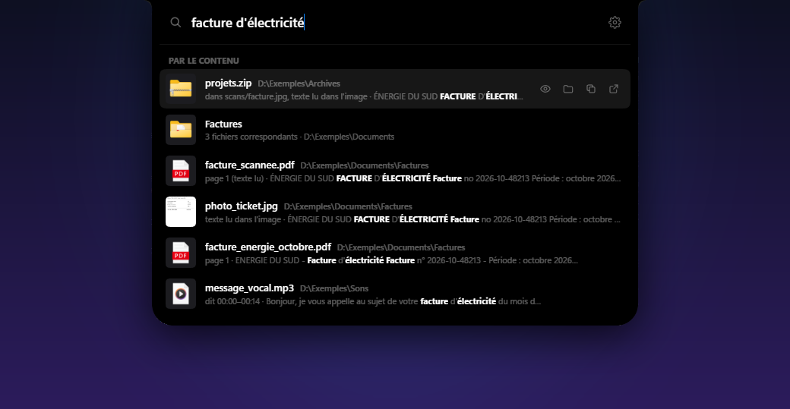
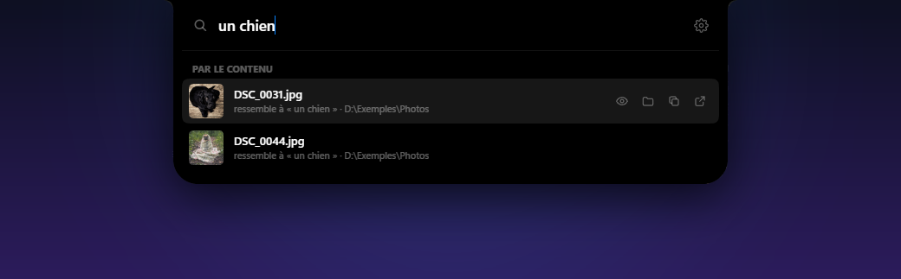
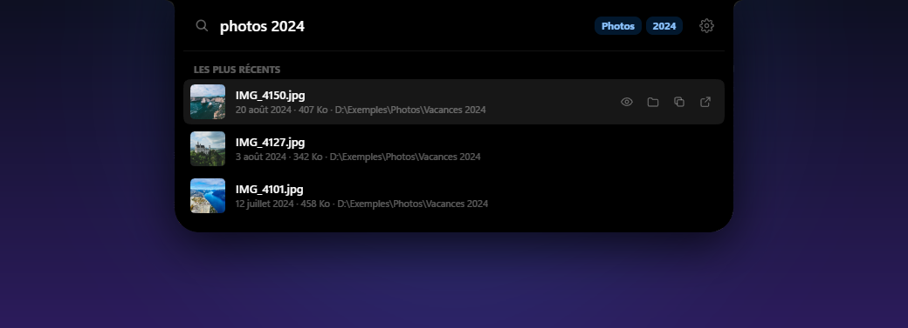
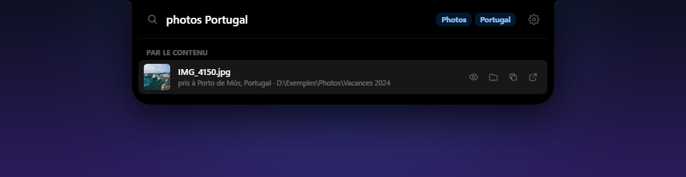
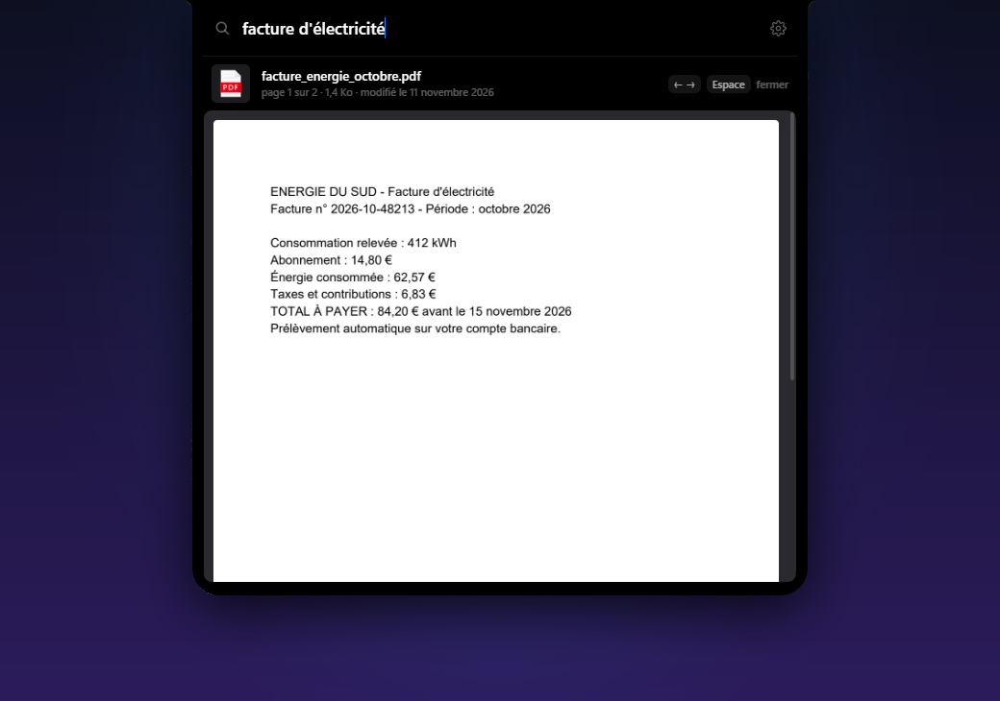
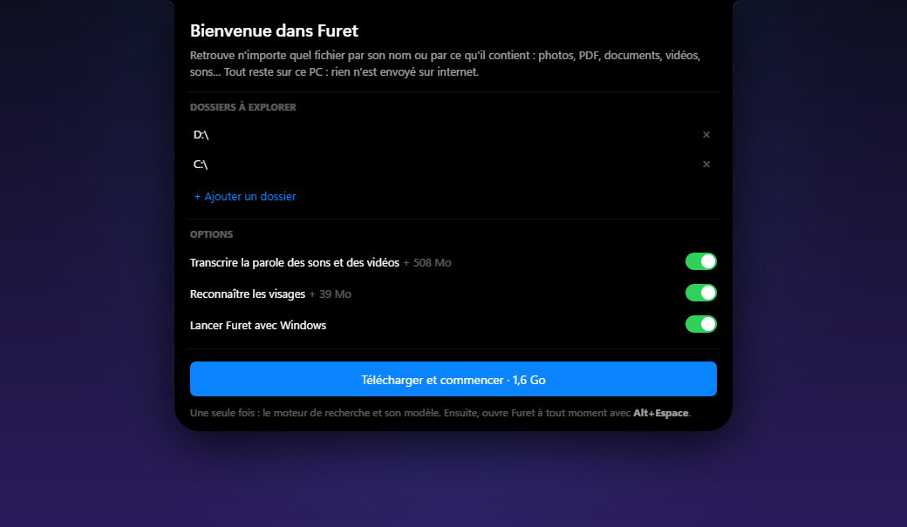
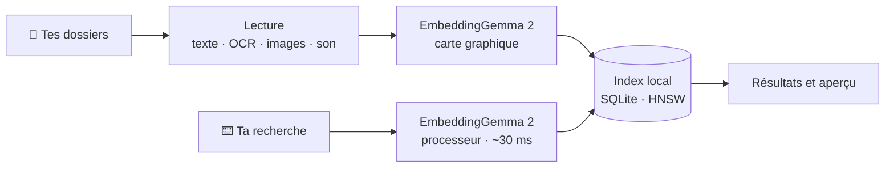

<div align="center">


# Furet

[English](README.md) · **Français**

**Retrouve n'importe quel fichier par ce qu'il contient.**<br>
Une barre, <kbd>Alt</kbd> + <kbd>Espace</kbd>, et tout reste sur ton PC.

[](https://github.com/blasteur1916/furet/releases/latest)
[](https://github.com/blasteur1916/furet/releases/latest)
[](LICENSE)
[](#-vie-privée)

<br>

<a href="https://github.com/blasteur1916/furet/releases/latest">
  
</a>

<sub>🧪 <b>Bêta publique</b> : ça marche, mais c'est jeune. <a href="https://github.com/blasteur1916/furet/issues/new">Dis-moi ce qui casse, ce qui manque, ce que tu aimerais chercher</a>.</sub>

<br><br>



<sub>« facture d'électricité » : un PDF, un PDF scanné, la photo d'un ticket, un message vocal et une archive. Aucun n'a « électricité » dans son nom.</sub>

</div>

<br>

## Pourquoi Furet

Tu te souviens de ce qu'il y avait **dans** un fichier, rarement de son nom. Furet cherche comme toi :

- **Par le sens** — « photo d'un chien », « la réunion où on parlait du budget », « contrat de location » : Furet comprend le texte, les images et ce qui se dit dans les sons et les vidéos.
- **Par le nom, partout** — tous les fichiers de tous les disques, en quelques millisecondes, suivis en direct.
- **Sans rien envoyer** — le modèle tourne sur ton PC. Pas de compte, pas de nuage, pas d'abonnement.

<br>

## Tout ce que Furet comprend

| | Type | Ce que Furet y trouve |
|:-:|---|---|
| 🖼️ | **Photos** | ce qu'elles montrent, le texte qu'elles contiennent (OCR), où et quand elles ont été prises |
| 📄 | **PDF** | leur texte, même scannés, avec la bonne page |
| 📝 | **Word, PowerPoint, OpenDocument** | leur texte, avec la bonne diapo |
| 📊 | **Excel, ODS, CSV** | le contenu de chaque feuille |
| 🎬 | **Vidéos** | leurs images et la parole, au moment exact |
| 🎙️ | **Sons et enregistrements** | ce qui y est dit, et leur ambiance |
| 🗒️ | **Notes, textes et code** | leur contenu, à la bonne ligne |
| 🗜️ | **Archives .zip** | les photos, PDF, documents et notes rangés dedans |

Les **mots exacts** comptent aussi : un numéro de facture ou un nom propre est retrouvé, avec le passage où il apparaît.

<br>

## En images

<table>
<tr>
<td width="50%" valign="top">

### Cherche ce que montrent tes photos
Aucune de ces photos ne s'appelle « chien ».



</td>
<td width="50%" valign="top">

### Filtre en écrivant
Type, date, taille : tape-les simplement, Furet les comprend.



</td>
</tr>
<tr>
<td width="50%" valign="top">

### Retrouve tes photos par lieu
D'après leur GPS, sans aucun service en ligne.



</td>
<td width="50%" valign="top">

### Regarde sans ouvrir
<kbd>Espace</kbd> : la page du PDF, la photo, la vidéo au bon moment.



</td>
</tr>
</table>

### Les filtres

| Tu tapes | Furet comprend |
|---|---|
| `pdf facture` | les PDF qui parlent de factures |
| `photos 2024` · `photos mars 2023` | les photos prises à cette date |
| `vidéos > 1 Go` · `devis moins de 2 Mo` | selon la taille |
| `modifié la semaine dernière` · `notes d'hier` · `contrat avant 2020` | selon la date |
| `vacances Espagne` · `photos Barcelone` | les photos prises à cet endroit |

### Les personnes
Nomme une photo `elliot.jpg` : chercher « elliot » retrouve aussi les autres photos où Elliot apparaît, même si elles s'appellent `IMG_2045.jpg`. La reconnaissance des visages se fait sur ton PC et peut être coupée dans les réglages.

<br>

## Raccourcis

| Touche | Action |
|---|---|
| <kbd>Alt</kbd> + <kbd>Espace</kbd> | ouvrir Furet, depuis n'importe où |
| <kbd>↑</kbd> <kbd>↓</kbd> | choisir un résultat |
| <kbd>Entrée</kbd> | ouvrir |
| <kbd>Espace</kbd> (après les flèches) ou <kbd>Maj</kbd> + <kbd>Espace</kbd> | aperçu |
| <kbd>←</kbd> <kbd>→</kbd> | pages du PDF, dans l'aperçu |
| <kbd>Ctrl</kbd> + <kbd>Entrée</kbd> | montrer dans le dossier |
| <kbd>Ctrl</kbd> + <kbd>C</kbd> | copier le chemin |
| <kbd>Ctrl</kbd> + <kbd>O</kbd> | ouvrir avec… |
| <kbd>Échap</kbd> | fermer l'aperçu, effacer, puis fermer |

Tu peux aussi **glisser** un résultat vers une autre appli ou un dossier : le fichier est copié, jamais déplacé. La barre vide propose les fichiers ouverts récemment.

<br>

## Installer

<table>
<tr>
<td width="46%" valign="top">

1. Télécharge **`Furet_…_x64-setup.exe`** sur la page des [versions](https://github.com/blasteur1916/furet/releases/latest) et lance-le. Aucun droit administrateur n'est demandé.
2. L'installateur n'est pas encore signé : si Windows affiche « Windows a protégé votre PC », clique sur **Informations complémentaires**, puis **Exécuter quand même**.
3. Choisis tes dossiers et tes options, puis **Télécharger et commencer**. Furet télécharge une seule fois son moteur et ses modèles (1,1 à 1,6 Go), chacun vérifié ; un téléchargement coupé reprend où il en était.
4. C'est prêt : <kbd>Alt</kbd> + <kbd>Espace</kbd>. Furet lit tes fichiers en arrière-plan ; tu peux chercher par le nom tout de suite.

Les mises à jour arrivent toutes seules.

</td>
<td width="54%" valign="top">



</td>
</tr>
</table>

**Configuration** : Windows 10 ou 11 (64 bits), environ 2 Go d'espace. Une carte graphique compatible Vulkan (NVIDIA, AMD, Intel Arc) accélère beaucoup l'indexation ; sans elle, tout marche sur le processeur, plus lentement.

<br>

## 🔒 Vie privée

- **Tout se passe sur ton PC.** Tes fichiers, ce que tu cherches et l'index ne quittent jamais ta machine.
- Furet ne se connecte à internet que pour télécharger son moteur et ses modèles la première fois, et pour vérifier les mises à jour.
- Ses journaux ne contiennent ni le contenu de tes fichiers ni ce que tu cherches.
- Retirer un dossier des réglages retire ses fichiers de l'index. Tout est rangé dans `%LOCALAPPDATA%\app.furet` et `%APPDATA%\app.furet`.

<br>

## Discret

- L'indexation tourne en arrière-plan, en priorité basse, et **se met en pause sur batterie, pendant un jeu ou une appli en plein écran** : la carte graphique est alors libérée.
- Une recherche prend une trentaine de millisecondes, sur le processeur ; la carte graphique reste au repos.
- Les grandes bibliothèques de code (moteurs de jeu, SDK) et les archives de logiciels ne comptent que par leur nom : l'index reste léger, et les résultats restent les tiens.

<br>

## Comment ça marche



Chaque passage de texte, chaque photo, chaque moment d'une vidéo devient un **vecteur**, une liste de nombres qui résume son sens. Ta recherche devient elle aussi un vecteur, et Furet cherche les plus proches, en plus des mots exacts et des noms.

| Pour | Furet utilise |
|---|---|
| Le sens des textes, des images et des sons | [EmbeddingGemma 2](https://huggingface.co/google/embeddinggemma-2) avec [llama.cpp](https://github.com/ggml-org/llama.cpp) (Vulkan ou processeur) |
| La parole | [Parakeet TDT v3](https://huggingface.co/nvidia/parakeet-tdt-0.6b-v3) avec [sherpa-onnx](https://github.com/k2-fsa/sherpa-onnx) |
| Le texte des images et des scans | l'OCR de Windows |
| Les PDF · les sons et les vidéos | [PDFium](https://pdfium.googlesource.com/pdfium/) · [FFmpeg](https://ffmpeg.org) |
| Les visages | YuNet et SFace d'[OpenCV Zoo](https://github.com/opencv/opencv_zoo), avec [tract](https://github.com/sonos/tract) |
| Les lieux | [GeoNames](https://www.geonames.org) et le [CLDR](https://cldr.unicode.org) |
| L'index | SQLite, [sqlite-vec](https://github.com/asg017/sqlite-vec), FTS5 et [usearch](https://github.com/unum-cloud/usearch) |
| L'appli | [Tauri 2](https://tauri.app), Rust et React |

Les mesures et les choix sont détaillés dans [RECHERCHE.md](RECHERCHE.md).

<br>

## Compiler

<details>
<summary>Depuis les sources</summary>

<br>

Il faut [Rust](https://rustup.rs) 1.88 ou plus récent, [Node.js](https://nodejs.org) et [pnpm](https://pnpm.io).

```powershell
cd app
pnpm install
pnpm tauri build --no-bundle   # → target\release\furet.exe
pnpm tauri build               # → et l'installateur, dans target\release\bundle\nsis
```

Au premier lancement, l'appli compilée télécharge son moteur et ses modèles comme la version installée. La variable `FURET_RACINE` lui donne un autre dossier.

```
moteur/   la librairie : indexation, recherche, OCR, transcription, visages, lieux, filtres
proto/    un outil en ligne de commande : index, cherche, stats
app/      l'appli : interface React (app/src) et Rust (app/src-tauri)
```

```powershell
cargo build --release -p furet-proto
target\release\furet-proto.exe --racine <dossier de Furet> index C:\Users\moi\Documents
target\release\furet-proto.exe --racine <dossier de Furet> cherche "facture d'électricité"
```

</details>

<br>

## Tes retours

Furet est en **bêta publique** (0.9). Chaque retour aide : une recherche qui n'a rien trouvé, un type de fichier mal lu, un plantage, un PC qui rame, une idée.

- [Ouvre une issue](https://github.com/blasteur1916/furet/issues/new), en français ou en anglais.
- Utile à préciser : ta version de Windows, ta carte graphique, le nombre de fichiers indexés, et ce que tu as cherché (si ça ne te gêne pas).
- Les journaux sont dans `%LOCALAPPDATA%\app.furet\logs` (jamais le contenu de tes fichiers ni tes recherches).

<br>

## Bientôt

- 🐧 **Linux** — le moteur est déjà écrit pour être portable.
- 🔏 **Installateur signé** — pour que Windows ne s'en méfie plus.

<br>

## Licence

Furet est un logiciel libre, sous licence [GPL-3.0](LICENSE).

<details>
<summary>Ce qu'il télécharge et utilise</summary>

<br>

- EmbeddingGemma 2, fourni selon les [conditions d'utilisation de Gemma](https://ai.google.dev/gemma/terms)
- llama.cpp — MIT
- Parakeet TDT v3 — CC BY 4.0 · sherpa-onnx — Apache 2.0
- YuNet — MIT · SFace — Apache 2.0
- PDFium — BSD · FFmpeg — GPL
- Villes de GeoNames — CC BY 4.0 · noms des pays du CLDR — licence Unicode
- Photos des captures d'écran : [Unsplash](https://unsplash.com/license)

</details>

<br>

<div align="center">
<sub>Fait avec soin, pour retrouver ce qu'on a perdu.</sub>
</div>
