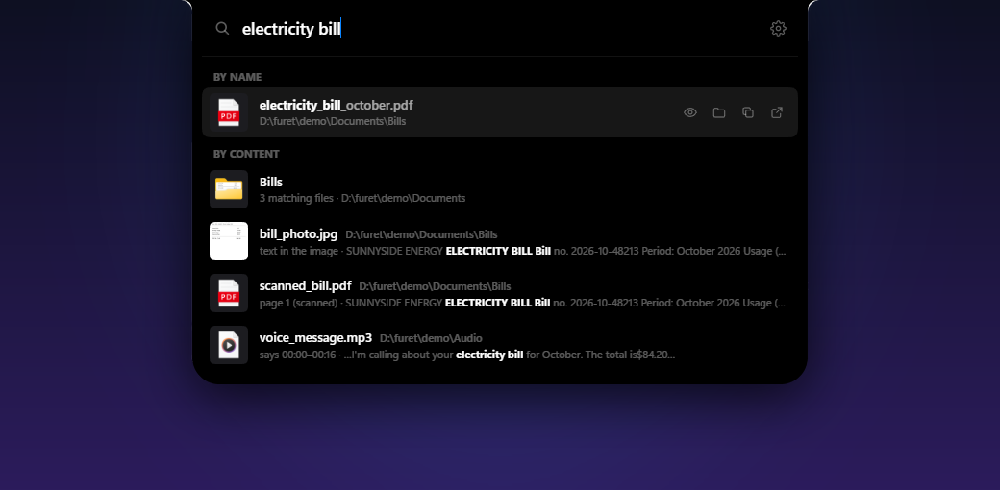
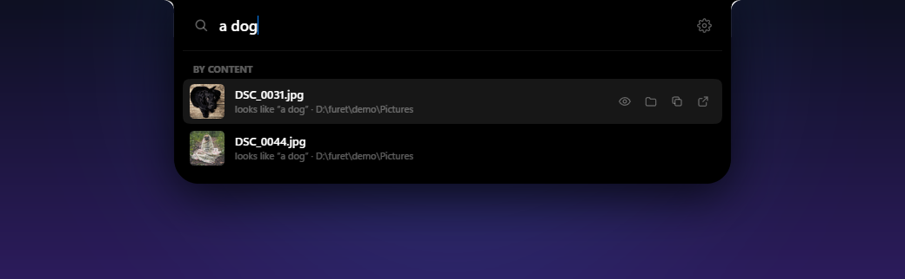
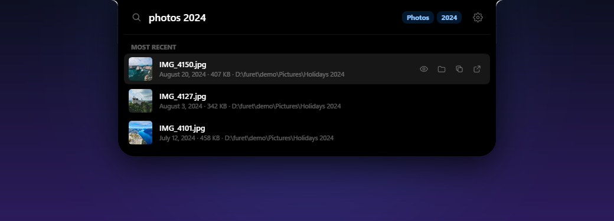
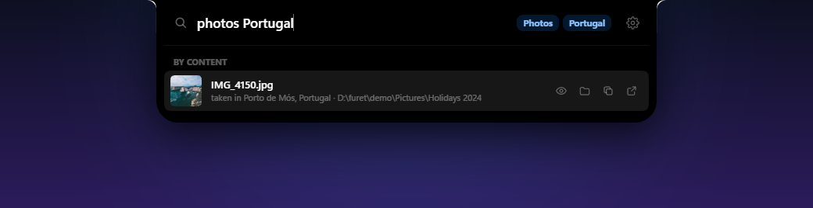
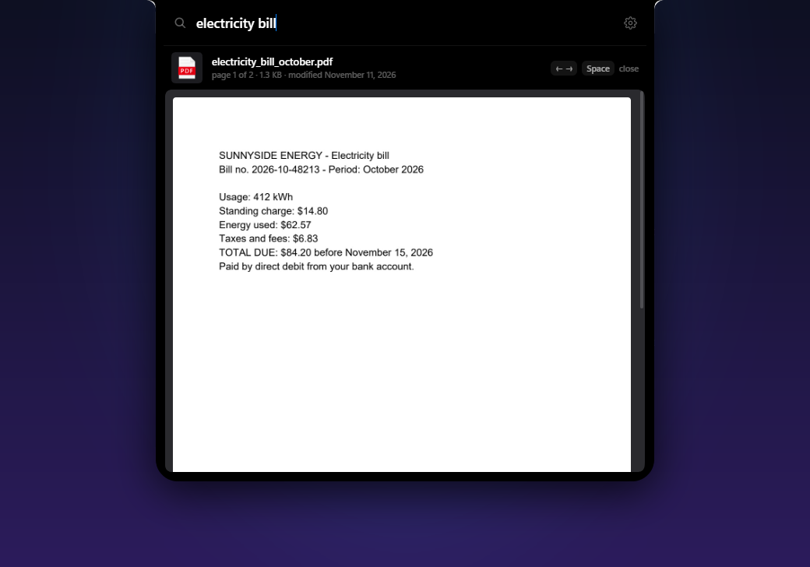
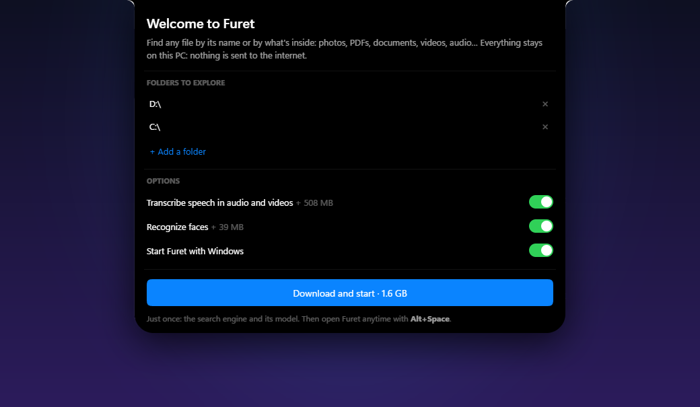
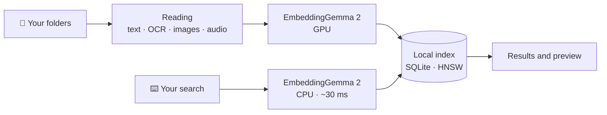

<div align="center">


# Furet

**English** · [Français](README.fr.md)

**Find any file by what's inside it.**<br>
One search bar, <kbd>Alt</kbd> + <kbd>Space</kbd>, and everything stays on your PC.

[](https://github.com/blasteur1916/furet/releases/latest)
[](https://github.com/blasteur1916/furet/releases/latest)
[](LICENSE)
[](#-privacy)

<br>

<a href="https://github.com/blasteur1916/furet/releases/latest">
  
</a>

<sub>🧪 <b>Public beta</b>: it works, but it's young. <a href="https://github.com/blasteur1916/furet/issues/new">Tell me what breaks, what's missing, what you'd search for</a>.</sub>

<br><br>



<sub>“electricity bill”: a PDF, a scanned PDF, a photo of a bill and a voice message that mentions it.</sub>

</div>

<br>

## Why Furet

You remember what was **in** a file, rarely what it was called. Furet searches the way you remember:

- **By meaning** — “a dog”, “the meeting where we talked about the budget”, “rental contract”: Furet understands text, images, and what is said in audio and video.
- **By name, everywhere** — every file on every drive, in a few milliseconds, kept up to date live.
- **Without sending anything** — the AI model runs on your PC. No account, no cloud, no subscription.

<br>

## What Furet understands

| | Type | What Furet finds in it |
|:-:|---|---|
| 🖼️ | **Photos** | what they show, the text in them (OCR), where and when they were taken |
| 📄 | **PDFs** | their text, even scanned, on the right page |
| 📝 | **Word, PowerPoint, OpenDocument** | their text, on the right slide |
| 📊 | **Excel, ODS, CSV** | the content of every sheet |
| 🎬 | **Videos** | their frames and their speech, at the exact moment |
| 🎙️ | **Audio and recordings** | what is said, and how it sounds |
| 🗒️ | **Notes, text and code** | their content, on the right line |
| 🗜️ | **.zip archives** | the photos, PDFs, documents and notes inside |

**Exact words** count too: an invoice number or a name is found, with the passage where it appears.

<br>

## In pictures

<table>
<tr>
<td width="50%" valign="top">

### Search what your photos show
None of these photos is called “dog”.



</td>
<td width="50%" valign="top">

### Filter as you type
Type, date, size: just type them, Furet gets it.



</td>
</tr>
<tr>
<td width="50%" valign="top">

### Find photos by place
From their GPS data, without any online service.



</td>
<td width="50%" valign="top">

### Look without opening
<kbd>Space</kbd>: the PDF page, the photo, the video at the right moment.



</td>
</tr>
</table>

### Filters

| You type | Furet understands |
|---|---|
| `pdf invoice` | PDFs about invoices |
| `photos 2024` · `pictures march 2023` | photos taken at that date |
| `videos > 1 GB` · `quote smaller than 2 MB` | by size |
| `modified last week` · `notes yesterday` · `contract before 2020` | by date |
| `holidays Spain` · `photos Barcelona` | photos taken at that place |

French works too: `photos de vacances 2024`, `vidéos > 1 Go`, `modifié la semaine dernière`.

### People
Name a photo `elliot.jpg`: searching “elliot” also finds the other photos where Elliot appears, even if they are called `IMG_2045.jpg`. Face recognition runs on your PC and can be turned off in the settings.

<br>

## Shortcuts

| Key | Action |
|---|---|
| <kbd>Alt</kbd> + <kbd>Space</kbd> | open Furet, from anywhere |
| <kbd>↑</kbd> <kbd>↓</kbd> | pick a result |
| <kbd>Enter</kbd> | open |
| <kbd>Space</kbd> (after the arrows) or <kbd>Shift</kbd> + <kbd>Space</kbd> | preview |
| <kbd>←</kbd> <kbd>→</kbd> | PDF pages, in the preview |
| <kbd>Ctrl</kbd> + <kbd>Enter</kbd> | show in folder |
| <kbd>Ctrl</kbd> + <kbd>C</kbd> | copy the path |
| <kbd>Ctrl</kbd> + <kbd>O</kbd> | open with… |
| <kbd>Esc</kbd> | close the preview, clear, then close |

You can also **drag** a result into another app or a folder: the file is copied, never moved. The empty bar shows the files you opened recently.

<br>

## Install

<table>
<tr>
<td width="46%" valign="top">

1. Download **`Furet_…_x64-setup.exe`** from the [releases page](https://github.com/blasteur1916/furet/releases/latest) and run it. No administrator rights needed.
2. The installer isn't signed yet: if Windows says “Windows protected your PC”, click **More info**, then **Run anyway**.
3. Pick your folders and options, then **Download and start**. Furet downloads its engine and models once (1.1 to 1.6 GB), each one verified; an interrupted download resumes where it stopped.
4. Done: <kbd>Alt</kbd> + <kbd>Space</kbd>. Furet reads your files in the background; searching by name works right away.

Updates arrive on their own.

</td>
<td width="54%" valign="top">



</td>
</tr>
</table>

**Requirements**: Windows 10 or 11 (64-bit), about 2 GB of disk space. A Vulkan-capable GPU (NVIDIA, AMD, Intel Arc) makes indexing much faster; without one, everything runs on the CPU, more slowly.

The interface is in English and French (it follows your Windows language, and can be changed in the settings).

<br>

## 🔒 Privacy

- **Everything happens on your PC.** Your files, your searches and the index never leave your machine.
- Furet only goes online to download its engine and models the first time, and to check for updates.
- Its logs contain neither the content of your files nor what you search for.
- Removing a folder from the settings removes its files from the index. Everything is stored in `%LOCALAPPDATA%\app.furet` and `%APPDATA%\app.furet`.

<br>

## Lightweight

- Indexing runs in the background at low priority, and **pauses on battery, during games or full-screen apps** — the GPU is freed.
- A search takes about thirty milliseconds, on the CPU; the GPU stays idle.
- Large code libraries (game engines, SDKs) and software archives only count by name: the index stays small, and the results stay yours.

<br>

## How it works



Every passage of text, every photo, every moment of a video becomes a **vector**, a list of numbers that sums up its meaning. Your search becomes a vector too, and Furet looks for the closest ones, on top of exact words and file names.

| For | Furet uses |
|---|---|
| The meaning of text, images and audio | [EmbeddingGemma 2](https://huggingface.co/google/embeddinggemma-2) with [llama.cpp](https://github.com/ggml-org/llama.cpp) (Vulkan or CPU) |
| Speech | [Parakeet TDT v3](https://huggingface.co/nvidia/parakeet-tdt-0.6b-v3) with [sherpa-onnx](https://github.com/k2-fsa/sherpa-onnx) |
| Text in images and scans | Windows OCR |
| PDFs · audio and video | [PDFium](https://pdfium.googlesource.com/pdfium/) · [FFmpeg](https://ffmpeg.org) |
| Faces | YuNet and SFace from [OpenCV Zoo](https://github.com/opencv/opencv_zoo), with [tract](https://github.com/sonos/tract) |
| Places | [GeoNames](https://www.geonames.org) and [CLDR](https://cldr.unicode.org) |
| The index | SQLite, [sqlite-vec](https://github.com/asg017/sqlite-vec), FTS5 and [usearch](https://github.com/unum-cloud/usearch) |
| The app | [Tauri 2](https://tauri.app), Rust and React |

Measurements and design choices are detailed (in French) in [RECHERCHE.md](RECHERCHE.md).

<br>

## Build

<details>
<summary>From source</summary>

<br>

You need [Rust](https://rustup.rs) 1.88 or newer, [Node.js](https://nodejs.org) and [pnpm](https://pnpm.io).

```powershell
cd app
pnpm install
pnpm tauri build --no-bundle   # → target\release\furet.exe
pnpm tauri build               # → plus the installer, in target\release\bundle\nsis
```

On first launch, the compiled app downloads its engine and models like the installed one. The `FURET_RACINE` variable points it to another folder.

```
moteur/   the library: indexing, search, OCR, speech, faces, places, filters
proto/    a command-line tool: index, cherche (search), stats
app/      the app: React interface (app/src) and Rust (app/src-tauri)
```

```powershell
cargo build --release -p furet-proto
target\release\furet-proto.exe --racine <Furet folder> index C:\Users\me\Documents
target\release\furet-proto.exe --racine <Furet folder> cherche "electricity bill"
```

</details>

<br>

## Feedback

Furet is in **public beta** (0.9). Every report helps: a search that found nothing, a file type it can't read, a crash, a slow PC, an idea.

- [Open an issue](https://github.com/blasteur1916/furet/issues/new) — in English or French.
- Useful to include: your Windows version, your GPU, how many files you indexed, and what you searched for (if you're OK sharing it).
- Logs are in `%LOCALAPPDATA%\app.furet\logs` (they never contain your files' content or your searches).

<br>

## Coming next

- 🐧 **Linux** — the engine is already written to be portable.
- 🔏 **Signed installer** — so Windows stops being suspicious of it.

<br>

## License

Furet is free software, under the [GPL-3.0](LICENSE) license.

<details>
<summary>What it downloads and uses</summary>

<br>

- EmbeddingGemma 2, provided under the [Gemma Terms of Use](https://ai.google.dev/gemma/terms)
- llama.cpp — MIT
- Parakeet TDT v3 — CC BY 4.0 · sherpa-onnx — Apache 2.0
- YuNet — MIT · SFace — Apache 2.0
- PDFium — BSD · FFmpeg — GPL
- GeoNames cities — CC BY 4.0 · CLDR country names — Unicode license
- Photos in the screenshots: [Unsplash](https://unsplash.com/license)

</details>

<br>

<div align="center">
<sub>Made with care, to find what you lost.</sub>
</div>
